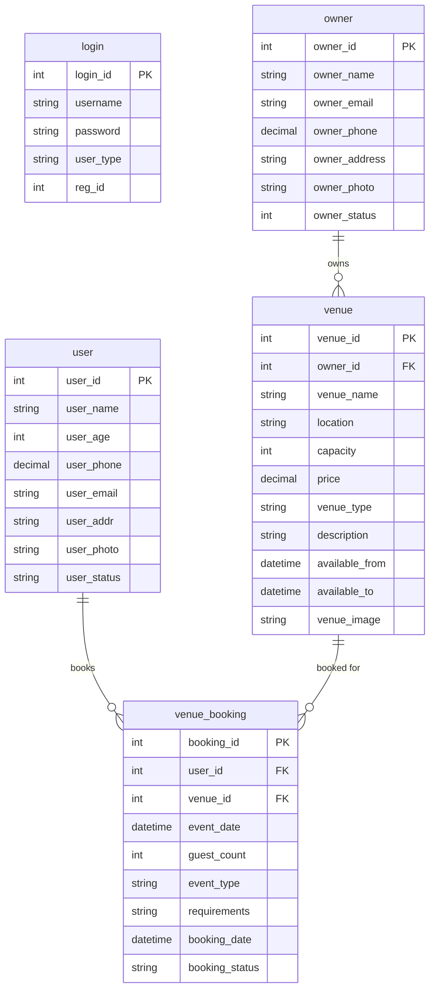
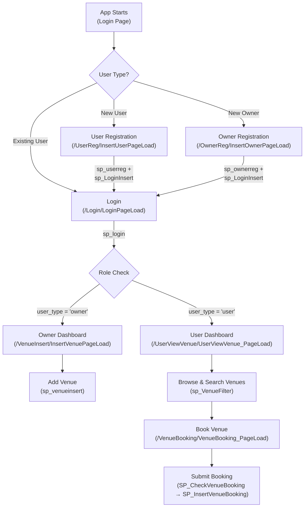

# 🏛️ Gatherly — Venue Booking & Management Platform

## 📌 Project Overview

**Gatherly** is a full-stack **Venue Booking and Management Web Application** built using the **ASP.NET MVC 5** framework with a **SQL Server** backend. The platform connects two types of users:

- **Venue Owners** — who can register and list their venues (marriage halls, resorts, auditoriums, etc.) with details like pricing, capacity, availability, and images.
- **Users (Customers)** — who can browse/search venues using filters (location, capacity, price, type), view venue details, and submit booking requests for specific dates.

The application features **role-based authentication**, meaning after login, owners are redirected to the venue management dashboard while users are redirected to the venue exploration page.

---

## 🏗️ Architecture — MVC (Model-View-Controller)

Gatherly follows the classic **ASP.NET MVC 5** architectural pattern:

```
┌─────────────────────────────────────────────────────────┐
│                      CLIENT (Browser)                   │
│             HTML / CSS / JavaScript / jQuery             │
└──────────────────────┬──────────────────────────────────┘
                       │  HTTP Request
                       ▼
┌─────────────────────────────────────────────────────────┐
│                   ROUTING ENGINE                        │
│            RouteConfig.cs  →  {controller}/{action}/{id}│
│            Default: Login/LoginPageLoad                  │
└──────────────────────┬──────────────────────────────────┘
                       │
                       ▼
┌─────────────────────────────────────────────────────────┐
│                    CONTROLLERS                          │
│  HomeController · LoginController · OwnerRegController  │
│  UserRegController · VenueInsertController              │
│  UserViewVenueController · VenueBookingController       │
└──────────┬────────────────────┬─────────────────────────┘
           │                    │
           ▼                    ▼
┌─────────────────┐  ┌──────────────────────────────────┐
│     MODELS      │  │           VIEWS (.cshtml)         │
│  (Data classes  │  │  Razor Views with HTML Helpers    │
│   + Validation) │  │  3 Layouts: _Layout, _OwnerLayout │
│                 │  │              _UserLayout           │
└────────┬────────┘  └──────────────────────────────────┘
         │
         ▼
┌─────────────────────────────────────────────────────────┐
│              DATA ACCESS LAYER                          │
│                                                         │
│  Entity Framework 6 (Database-First)                    │
│  ┌───────────────┐     ┌─────────────────────────┐     │
│  │ Model1.edmx   │────▶│ GatherlyEntities        │     │
│  │ (EDMX Model)  │     │ (DbContext)              │     │
│  └───────────────┘     └──────────┬──────────────┘     │
│                                   │                     │
│  ADO.NET (SqlConnection/Command)  │  ◄── Hybrid        │
│  Used in: UserViewVenue,          │      Approach       │
│           VenueBooking Controllers│                     │
└───────────────────────────────────┼─────────────────────┘
                                    │
                                    ▼
┌─────────────────────────────────────────────────────────┐
│                  SQL SERVER DATABASE                     │
│                  Database: Gatherly                      │
│                  Instance: SQLEXPRESS                    │
│                                                         │
│  Tables: login, user, owner, venue, venue_booking       │
│  Stored Procedures: sp_login, sp_ownerreg, sp_userreg,  │
│    sp_LoginInsert, sp_maxLogId, sp_venueinsert,          │
│    sp_UserViewVenue, sp_VenueFilter,                     │
│    SP_CheckVenueBooking, SP_InsertVenueBooking,          │
│    SP_GetBookedDates                                     │
└─────────────────────────────────────────────────────────┘
```

---

## 🛠️ Technology Stack

| Layer            | Technology                                          |
|------------------|-----------------------------------------------------|
| **Framework**    | ASP.NET MVC 5 (v5.2.7)                             |
| **Language**     | C# (.NET Framework 4.7.2)                           |
| **View Engine**  | Razor (.cshtml)                                     |
| **ORM**          | Entity Framework 6.2.0 (Database-First approach)    |
| **Database**     | Microsoft SQL Server (SQL Express)                  |
| **Data Access**  | EF6 (via EDMX) + Raw ADO.NET (SqlConnection/Command)|
| **Frontend CSS** | Bootstrap 3.4.1                                     |
| **Frontend JS**  | jQuery 3.4.1, jQuery Validate, Modernizr 2.8.3      |
| **Validation**   | Data Annotations (server) + jQuery Unobtrusive (client) |
| **JSON**         | Newtonsoft.Json 12.0.2                              |
| **Bundling**     | ASP.NET Web Optimization (BundleConfig)             |
| **IDE**          | Visual Studio 2019+ (Solution Format v12)           |
| **Server**       | IIS Express (development)                           |

---

## 📂 Folder Structure

```
Gatherly/                          ← Repository Root
├── Gatherly.sln                   ← Visual Studio Solution File
├── Gatherly_*.bak                 ← SQL Server Database Backup
│
└── Gatherly/                      ← Main MVC Project
    ├── App_Start/
    │   ├── BundleConfig.cs        ← JS/CSS bundle definitions
    │   ├── FilterConfig.cs        ← Global MVC filters
    │   └── RouteConfig.cs         ← URL routing rules
    │
    ├── Controllers/
    │   ├── HomeController.cs      ← Landing pages (Index, About, Contact)
    │   ├── LoginController.cs     ← Authentication (Login, Logout)
    │   ├── OwnerRegController.cs  ← Owner registration
    │   ├── UserRegController.cs   ← User registration
    │   ├── VenueInsertController.cs    ← Add new venue (Owner)
    │   ├── UserViewVenueController.cs  ← Browse/search venues (User)
    │   └── VenueBookingController.cs   ← Book a venue (User)
    │
    ├── Models/
    │   ├── Loginclss.cs           ← Login form model
    │   ├── OwnerRegclss.cs        ← Owner registration model
    │   ├── UserRegclss.cs         ← User registration model
    │   ├── VenueInsertclss.cs     ← Venue creation model
    │   ├── VenueBookingclss.cs    ← Venue booking model
    │   ├── UserViewVenueclss.cs   ← Venue display model
    │   └── VenueSearchclss.cs     ← Venue search/filter model
    │
    ├── Views/
    │   ├── Shared/
    │   │   ├── _Layout.cshtml         ← Public layout (Login, Registration)
    │   │   ├── _OwnerLayout.cshtml    ← Owner dashboard layout
    │   │   ├── _UserLayout.cshtml     ← User dashboard layout
    │   │   └── Error.cshtml           ← Error page
    │   ├── Home/                      ← Index, About, Contact views
    │   ├── Login/
    │   │   └── LoginPageLoad.cshtml   ← Login form
    │   ├── OwnerReg/
    │   │   └── InsertOwnerPageLoad.cshtml  ← Owner registration form
    │   ├── UserReg/
    │   │   └── InsertUserPageLoad.cshtml   ← User registration form
    │   ├── VenueInsert/
    │   │   └── InsertVenuePageLoad.cshtml  ← Add venue form (Owner)
    │   ├── UserViewVenue/
    │   │   └── UserViewVenue_PageLoad.cshtml ← Browse venues with filters
    │   ├── VenueBooking/
    │   │   └── VenueBooking_PageLoad.cshtml  ← Booking form + venue details
    │   ├── _ViewStart.cshtml          ← Default layout assignment
    │   └── Web.config                 ← Views-specific config
    │
    ├── Content/
    │   ├── bootstrap.css / .min.css   ← Bootstrap stylesheets
    │   ├── bootstrap-theme.css        ← Bootstrap theme
    │   └── Site.css                   ← Custom styles
    │
    ├── Scripts/
    │   ├── jquery-3.4.1.js            ← jQuery library
    │   ├── jquery.validate.js         ← Client-side validation
    │   ├── jquery.validate.unobtrusive.js  ← Unobtrusive validation
    │   ├── bootstrap.js               ← Bootstrap JS
    │   └── modernizr-2.8.3.js         ← Feature detection
    │
    ├── Photo/                         ← User/Owner profile photos
    ├── VenuePhoto/                    ← Venue images
    ├── fonts/                         ← Bootstrap icon fonts
    │
    ├── Model1.edmx                    ← Entity Framework EDMX model
    ├── Model1.Context.cs              ← Auto-generated DbContext
    ├── Model1.Context.tt              ← T4 template for context
    ├── Model1.tt                      ← T4 template for entities
    │
    ├── login.cs                       ← EF entity: login table
    ├── owner.cs                       ← EF entity: owner table
    ├── user.cs                        ← EF entity: user table
    ├── venue.cs                       ← EF entity: venue table
    ├── venue_booking.cs               ← EF entity: venue_booking table
    ├── sp_login_Result.cs             ← SP result class: sp_login
    ├── sp_UserViewVenue_Result.cs     ← SP result class: sp_UserViewVenue
    │
    ├── Global.asax / Global.asax.cs   ← Application startup
    ├── Web.config                     ← Main configuration
    ├── packages.config                ← NuGet package references
    └── favicon.ico                    ← Browser tab icon
```

---

## 🗄️ Database Schema

### Tables

| Table            | Key Columns                                                                                 |
|------------------|---------------------------------------------------------------------------------------------|
| **login**        | `login_id` (PK), `username`, `password`, `user_type` ("owner"/"user"), `reg_id` (FK)       |
| **owner**        | `owner_id` (PK), `owner_name`, `owner_email`, `owner_phone`, `owner_address`, `owner_photo`, `owner_status` |
| **user**         | `user_id` (PK), `user_name`, `user_age`, `user_phone`, `user_email`, `user_addr`, `user_photo`, `user_status` |
| **venue**        | `venue_id` (PK), `owner_id` (FK), `venue_name`, `location`, `capacity`, `price`, `venue_type`, `catering`, `parking`, `ac`, `description`, `available_from`, `available_to`, `venue_status`, `venue_image` |
| **venue_booking**| `booking_id` (PK), `user_id` (FK→user), `venue_id` (FK→venue), `event_date`, `guest_count`, `event_type`, `requirements`, `booking_date`, `booking_status` |

### Entity Relationships



---

## ⚙️ Stored Procedures Used

The application **heavily relies on SQL Server stored procedures** for data operations:

| Stored Procedure          | Purpose                                              | Called From                |
|---------------------------|------------------------------------------------------|----------------------------|
| `sp_login`                | Authenticate user; returns `reg_id` and `user_type`  | `LoginController`          |
| `sp_LoginInsert`          | Insert credentials into `login` table                | `OwnerRegController`, `UserRegController` |
| `sp_maxLogId`             | Get max `login_id` to generate next `reg_id`         | `OwnerRegController`, `UserRegController` |
| `sp_ownerreg`             | Insert new owner into `owner` table                  | `OwnerRegController`       |
| `sp_userreg`              | Insert new user into `user` table                    | `UserRegController`        |
| `sp_venueinsert`          | Insert new venue into `venue` table                  | `VenueInsertController`    |
| `sp_UserViewVenue`        | Fetch all venues for display                         | EF Context (mapped)        |
| `sp_VenueFilter`          | Dynamic venue search with filters (via ADO.NET)      | `UserViewVenueController`  |
| `SP_CheckVenueBooking`    | Check if a venue is already booked on a given date   | `VenueBookingController`   |
| `SP_InsertVenueBooking`   | Insert a new booking request                         | `VenueBookingController`   |
| `SP_GetBookedDates`       | Get all booked dates for a venue (calendar blocking) | `VenueBookingController`   |

---

## 🔄 MVC Breakdown — Controller ↔ Model ↔ View Mapping

| Controller                  | Model(s) Used                            | View(s)                            | Layout Used        |
|-----------------------------|------------------------------------------|------------------------------------|--------------------|
| `HomeController`            | —                                        | `Index`, `About`, `Contact`        | `_Layout`          |
| `LoginController`           | `Loginclss`                              | `LoginPageLoad`                    | `_Layout`          |
| `OwnerRegController`        | `OwnerRegclss`                           | `InsertOwnerPageLoad`              | `_Layout`          |
| `UserRegController`         | `UserRegclss`                            | `InsertUserPageLoad`               | `_Layout`          |
| `VenueInsertController`     | `VenueInsertclss`                        | `InsertVenuePageLoad`              | `_OwnerLayout`     |
| `UserViewVenueController`   | `VenueSearchclss`, `UserViewVenueclss`   | `UserViewVenue_PageLoad`           | `_UserLayout`      |
| `VenueBookingController`    | `VenueBookingclss`                       | `VenueBooking_PageLoad`            | `_UserLayout`      |

---

## 🎨 Frontend Details

- **CSS Framework**: Bootstrap 3.4.1 — provides responsive grid layout, navbar, tables, buttons, alerts, and form styling.
- **JavaScript Libraries**:
  - **jQuery 3.4.1** — DOM manipulation and AJAX.
  - **jQuery Validate + Unobtrusive** — client-side form validation wired to Data Annotation attributes on model classes.
  - **Modernizr 2.8.3** — browser feature detection for progressive enhancement.
- **Razor View Engine** — server-side HTML generation using `@Html.TextBoxFor()`, `@Html.DropDownListFor()`, `@Html.ActionLink()`, `@Html.BeginForm()` helpers.
- **Three Layout Templates**:
  - `_Layout.cshtml` — public pages (Login, Registration) with links to Login, User Registration, Owner Registration.
  - `_OwnerLayout.cshtml` — owner dashboard with session-based welcome message ("Welcome, OwnerName") and Logout.
  - `_UserLayout.cshtml` — user dashboard with Home, Explore Venues navigation, welcome message, and Logout.

---

## 🔐 Backend Details

### Authentication & Session Management
- Login via **stored procedure** (`sp_login`) that validates username/password and returns `reg_id` + `user_type`.
- **Role-based redirection**: Owners → `VenueInsert/InsertVenuePageLoad`, Users → `UserViewVenue/UserViewVenue_PageLoad`.
- **Session variables** used: `owner_id`, `owner_name`, `user_id`, `user_name`.
- Logout clears and abandons the session.

### Data Access — Hybrid Approach
The project uses **two data access strategies**:

1. **Entity Framework 6 (Database-First via EDMX)**
   - Used for: Login, Owner registration, User registration, Venue insertion.
   - The `GatherlyEntities` DbContext is auto-generated from `Model1.edmx`.
   - Stored procedures are imported as methods on the context (`dbobj.sp_login()`, `dbobj.sp_ownerreg()`, etc.).
   - LINQ queries are used for fetching owner/user names after login.

2. **Raw ADO.NET (SqlConnection + SqlCommand)**
   - Used for: Venue search/filter (`sp_VenueFilter`), Booking operations (`SP_CheckVenueBooking`, `SP_InsertVenueBooking`, `SP_GetBookedDates`), and fetching venue details.
   - Connection string `importdataconnection` in `Web.config` is used for these operations.

### Validation
- **Server-side**: Data Annotation attributes on model classes — `[Required]`, `[EmailAddress]`, `[RegularExpression]`, `[Range]`, `[Compare]`.
- **Client-side**: jQuery Unobtrusive Validation that reads data annotation metadata from rendered HTML.

### File Upload
- Owner/User **profile photos** are saved to `/Photo/` folder.
- **Venue images** are saved to `/VenuePhoto/` folder.
- File paths are stored in the database (relative paths like `~\Photo\filename.jpg`).

---

## 🚀 Application Flow



---

## 🖥️ How to Run the Project

### Prerequisites
1. **Visual Studio 2019** or later (with ASP.NET and web development workload)
2. **SQL Server** (SQL Express or full edition)
3. **.NET Framework 4.7.2** (targeting runtime)

### Steps

1. **Clone / Open the Project**
   ```
   Open Gatherly.sln in Visual Studio
   ```

2. **Restore the Database**
   - Open **SQL Server Management Studio (SSMS)**.
   - Right-click **Databases** → **Restore Database**.
   - Select **Device** → browse to `Gatherly_20261019_194228.bak` (located in the repo root).
   - Restore it as database name `Gatherly`.

3. **Update Connection Strings** (if needed)
   
   Open [`Web.config`](file:///d:/Gatherly/Gatherly/Gatherly/Web.config) and update the **server name** in both connection strings to match your SQL Server instance:
   ```xml
   <!-- Entity Framework connection -->
   <add name="GatherlyEntities" 
        connectionString="...data source=YOUR_SERVER\SQLEXPRESS;
        initial catalog=Gatherly;integrated security=True;..." />

   <!-- ADO.NET connection -->
   <add name="importdataconnection" 
        connectionString="Server=YOUR_SERVER\SQLEXPRESS;
        Database=Gatherly;integrated security=true;" />
   ```

4. **Restore NuGet Packages**
   - In Visual Studio: Right-click Solution → **Restore NuGet Packages**.

5. **Build & Run**
   - Press **F5** (or **Ctrl+F5** for without debugging).
   - The app launches in the browser at the **Login page** (`/Login/LoginPageLoad`).

6. **Test the Application**
   - Register as an **Owner** → Login → Add venues.
   - Register as a **User** → Login → Browse venues → Book a venue.

---

## 📊 Key Features Summary

| Feature                     | Description                                                       |
|-----------------------------|-------------------------------------------------------------------|
| 🔐 Role-Based Auth          | Separate flows for Owner and User after login                    |
| 🏢 Venue Management         | Owners can add venues with images, pricing, capacity, type       |
| 🔍 Venue Search & Filter    | Filter by location, capacity, price, and venue type              |
| 📅 Venue Booking             | Users book venues with date selection, guest count, event type   |
| 🚫 Double-Booking Prevention | Checks for existing bookings on selected date (server + client) |
| 📷 Image Upload              | Profile photos for users/owners, venue images                   |
| ✅ Validation                | Client-side (jQuery) + Server-side (Data Annotations)            |
| 🗃️ Stored Procedures         | All major DB operations go through SQL Server SPs               |
| 📱 Responsive Design         | Bootstrap 3 ensures mobile-friendly layout                      |

---

> **Note**: This project uses **Windows Authentication** (Integrated Security) for database access — no separate DB username/password is required. Ensure your Windows account has access to the SQL Server instance.
